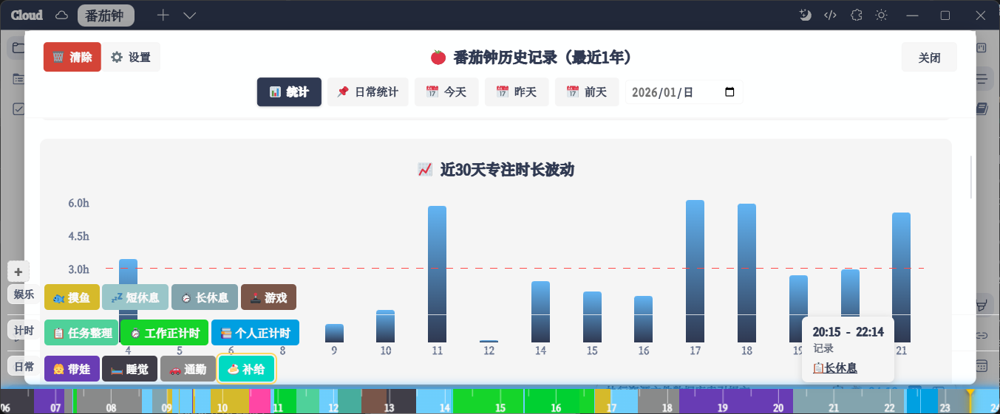

[简体中文](README_zh_CN.md)

# Dock Tomato

Dock Tomato is a Pomodoro timer and focus stopwatch for SiYuan. Start from the status bar, a task block, or a database cell. Review sessions on a timeline, manage reminders, play background audio, and synchronize timer state across devices. A floating timer is available on desktop and mobile.

## 2.3.9 Release notes

- **Added: English interface (i18n)**
  - English and Simplified Chinese across timers, the timeline, reminders, history and statistics, audio, settings, and desktop / mobile floating timers.
  - Choose **Follow SiYuan / 简体中文 / English** under **General → Interface language**, then click **Reload interface**. The choice syncs with plugin settings; custom names and content are preserved.
- Improved: Settings tabs scroll horizontally for small screens and longer English labels.
- Improved: Expanded English documentation and translation guidance; improved cross-platform packaging and language resource checks.

Previous updates (click to expand)

See the [Chinese release history](README_zh_CN.md) for 2.3.8 and earlier.

## Install or update

Requires SiYuan 3.8.1 or later.

- **Marketplace:** open SiYuan Settings → Marketplace → Plugins, search for **Dock Tomato** (底栏番茄钟), install it, and enable it.
- **Manual installation:** extract `package.zip` from a [release](https://github.com/5kyfkr/siyuan-plugin-docktomato/releases) into `{workspace}/data/plugins/siyuan-plugin-docktomato/`, then restart SiYuan.

Keep the plugin folder name when updating. Both languages use the same plugin identity, settings, and history.

## Interface language

Open **Dock Tomato settings → General → Interface language** and choose **Follow SiYuan**, **简体中文**, or **English**. Click **Reload interface** after saving to apply the choice. Unsupported SiYuan languages fall back to English.

The choice is saved in synchronized plugin settings and shared across devices. Follow SiYuan uses each device's SiYuan language. Allow SiYuan to sync before reloading another device. Task titles, custom routine and group names, notes, attribute names, stored dates, and time zones keep their original meaning.

## Start timing

1. Open the timer from the desktop status bar or the mobile document header.
2. Choose a Pomodoro duration, a focus stopwatch, or a break. Set default durations and quick presets under General settings.
3. Pause, resume, or finish from the timer controls. Record a distraction when needed; extending a Pomodoro by one minute is configurable.
4. Use a block or database menu to start a timer linked to a task. Supported task focus attributes update through the existing integration.

Desktop settings control the floating window's visibility, style, color mode, opacity, and size. Mobile provides a draggable floating timer. Closing a floating window keeps the timer running.

## Timeline, routines, and history

The bottom timeline shows focus, breaks, and routine activities. Add routine buttons, assign groups, change their order, and optionally link them to blocks. Timeline settings control the visible range, ticks, colors, and expansion area.

Open **History & statistics** to review sessions and daily, weekly, or monthly totals. Optional focus periods filter statistics to configured weekdays and time ranges. You can correct or remove records and export supported history as an ICS calendar file. Back up history before clearing it or making large edits.

## Reminders

Use a block or database menu to add a reminder. The reminder dock groups upcoming, overdue, and completed reminders. Standalone reminders have their own repeat schedule; task-linked reminders can follow Task Horizon's task schedule.

Reminder settings control SiYuan dialogs, system notifications, sound, and supported WeChat delivery. Availability depends on the client and notification permissions. WeChat delivery sends task titles and times to SiYuan's cloud; enabling it asks for confirmation.

Automatic title date recognition retains its Chinese vocabulary and supported numeric formats. Selecting English does not add an English natural-language date parser. Use the date and time controls for unambiguous scheduling.

## Audio and appearance

Audio settings support completion sounds, background audio, uploaded files, and a focus playlist. Choose playlist repeat or repeat-one playback, adjust volume, and test tracks. Focus and break audio have separate settings.

Appearance settings control themes, colors, indicators, and optional animations. Task block settings control accumulated focus-time and Pomodoro-count attributes.

## Synchronization and integrations

Enable timer synchronization under **Sync** to continue sessions across devices. SiYuan synchronizes workspace files; changes may take time to reach another device. Configure automatic SiYuan sync and task-link synchronization separately.

Dock Tomato works independently. Optional integrations include Task Horizon for task timing and reminders, Lumina for journal entries, and third-party focus plugins. Enable and configure each integration you use. Task Horizon and Dock Tomato have independent language choices.

Settings and history live under `data/storage/petal/siyuan-plugin-docktomato/` in the workspace. Existing legacy data migration and history storage behavior are retained. Back up your workspace before moving or importing data.

## Support and translations

- [Report a bug or request a feature](https://github.com/5kyfkr/siyuan-plugin-docktomato/issues)
- [Releases](https://github.com/5kyfkr/siyuan-plugin-docktomato/releases)
- [Full Chinese guide and previous updates](README_zh_CN.md)
- QQ community: **758666272**; discussion is primarily in Chinese.

Include the plugin and SiYuan versions, device type, reproduction steps, and relevant screenshots in bug reports. Remove private task content.

Edit translations directly in `i18n/en.json` and `i18n/zh-CN.json`. See the [translation maintenance guide](https://github.com/5kyfkr/siyuan-plugin-docktomato/blob/main/docs/i18n.md). Update both README files when changing user workflows or settings.
